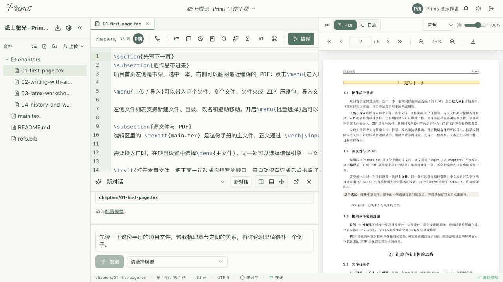
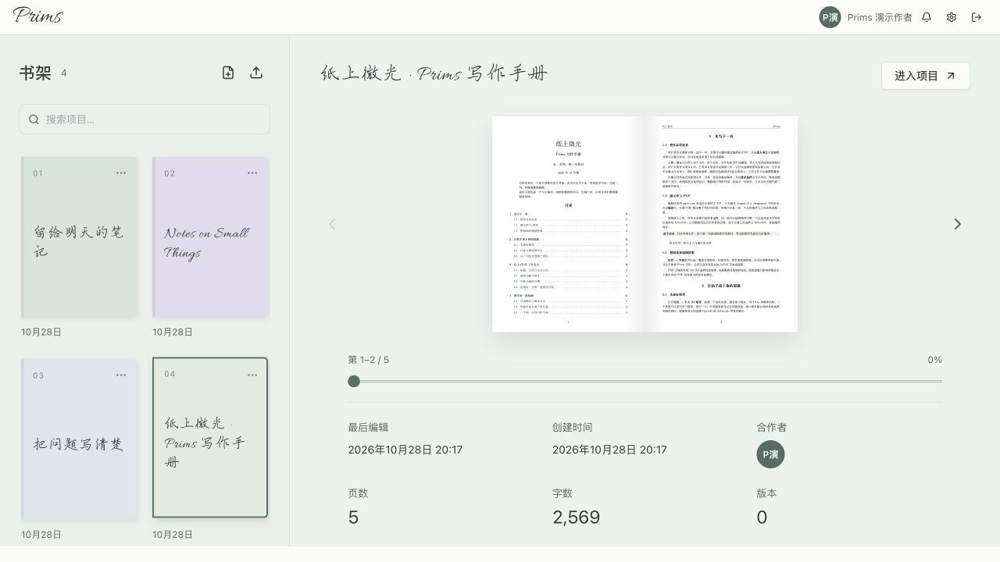

# Prims

**Compose with AI**

把想法写下来，和 AI 一起慢慢写好。

[写作体验](#一起写也一起改) · [界面一览](#把项目放回书架) · [自己部署](#run-from-source) · [来源与许可](#来源与致谢)

我想做一个写 LaTeX 时真正用得上的 AI 搭档：能跟着项目看文件，接着之前的讨论往下写，也能把修改摊开，让人看得明白、改得放心。

Prims 是我基于 [Scribe](https://github.com/sunnyallana/Scribe) 持续打磨的自托管协作编辑器。这里的重点是“一起写”：讨论围绕项目继续，建议落到具体文件里，留下什么、撤回什么，仍由写作者决定。

*截图来自实际运行的 Web 界面，使用专门的演示账号和合成内容。提问框里是尚未发送的示例草稿，没有调用外部模型。*

## 一起写，也一起改

选中一段文字，可以从这里提问；打开项目助手，也可以从整篇文章的目标开始讨论。需要上下文时，助手能在当前项目里查找文件、搜索内容、读取相关片段，继续处理多个文件中的关联修改。

我希望这些帮助最后能变成清楚、可判断的建议：

- **看见改了哪里。** 修改以逐段差异预览呈现，可以先调整候选文字，再分别接受或拒绝。
- **掌握应用的时机。** 候选不会直接写进正文；接受后仍可撤销，原文发生变化时也会重新核对位置。
- **把讨论接下去。** 你的项目对话会保留，支持新建、切换和继续讨论；写作目标与上下文会随项目一起延续。
- **按自己的方式摆放助手。** 停靠在右侧或底部、自由浮动，或放进独立标签页，写作与讨论可以保持在同一个流程里。

解释一个概念、讨论一种表达，或先把问题聊清楚，也都是这个助手的工作。

写过的文字也值得留住。自动保存与版本时间线记录写作过程，回头可以看差异、找回旧内容；需要时，也能让 AI 根据改动写一段版本摘要。

### 接入你自己的模型

Prims 使用你自己配置的 API 地址、Key 和模型。一个账号可以保存多组模型连接，每个连接也可以列出多个模型，在提问时选择本轮使用的模型；支持 OpenAI 兼容接口和 Anthropic 格式连接，具体能力取决于所选服务与模型。

连接配置属于各自账号，密钥在服务端加密保存。没有配置 AI 时，仍然可以编辑和编译项目。

个人设置里也有用量视图，可以按天、七天或一个月回顾 Token 消耗；接口提供缓存信息时，会把输入的缓存命中与未命中分开统计。

### 编译报错，就从日志接着改

日志页的 **AI调试并修复** 会把这次编译的日志、主文件和引擎带进项目助手，启动诊断。助手可以继续核对相关文件、提出修改，仍然沿用逐段预览和接受流程。

项目可以选择 **XeLaTeX、LuaLaTeX 或 pdfLaTeX**，默认使用 XeLaTeX。编译在隔离的 [TeX 工作器](servers/workbench/README.md)中完成，支持项目内字体和图片；编译环境仍需准备好文档用到的宏包。

## 把项目放回书架

项目在书架上摆开，旁边就能翻阅已经编译的 PDF。回到编辑器，文件、正文、PDF 和讨论各有自己的位置。项目空闲后，后台会生成较轻的 PDF 副本供翻书使用，原件和下载保持不变。

可以从模板起步，也可以选择文件夹、导入 ZIP，或直接上传文件，继续整理主文档和项目目录。每个项目可保存 **500 MiB 的源文件与附件**，编译产物和版本历史另计。新账号会收到一份可编辑的“纸上微光”教程，里面有排版示例，也介绍了日常使用方式。

## 也认真做了它的样子

写作工具会被盯着看很久，所以我也希望它舒服一点。明暗主题、书名字体、编辑器字体和 PDF 阅读外观可以分别调整；这些选择改变的是写作空间，文档排版仍由 LaTeX 决定。

登录页上，莫奈的画作慢慢轮换。登录与注册之间切换时，画面会接着走。

截图中的部分中文书名字体由实例自行提供，字体文件不随仓库发布；缺少时会使用回退字体。

## 想自己搭起来

Prims 保留了上游的开发脚本和 Docker 配置，也增加了自己的数据库扩展。部署需要准备应用、数据库、认证、存储、Redis 和编译环境；相关文档是起点，仍需按自己的服务器完成配置。

1. 从[开发脚本说明](scripts/README.md)、[环境变量说明](docs/env-vars.md)和[自托管指南](docs/self-hosting.md)开始，了解各项依赖与运行方式。
2. 完成上游迁移后，按 [Prims 数据库扩展说明](supabase/prims/README.md)准备附加表和函数。Prims 的手动 SQL 扩展不会由上游迁移器自动执行；初始管理员、邀请码与邮箱验证也需要按文档安排。
3. 配置并保管好自己的环境变量和持久加密密钥，再构建 Web 与 Rust 服务。实际发布需要处理 HTTPS、WebSocket、存储、备份和升级。
4. 原生编译引擎参考[工作器文档](servers/workbench/README.md)。需要注册、验证码或重置邮件时，再按[邮件服务说明](deploy/mail/README.md)完成相应配置与投递验证。

如果和同学、朋友一起用，管理员可以在站点管理里配置邮件、生成邀请码、查找用户。需要清理账号时，确认框会先展示涉及的项目与附件，再由管理员输入邮箱确认永久删除。

应用运行后，在个人设置里添加自己的模型连接即可开始共写。仓库也保留了[桌面端代码](apps/desktop/README.md)；这个分支目前主要围绕浏览器中的写作体验打磨。

项目容量和编译副本都支持 500 MiB。大项目采用流式传输；工作器的内存、运行时间和并发预算需要按自己的服务器配置。

### 代码在哪里

| 部分 | 入口 |
| --- | --- |
| Web 编辑器与界面 | [`apps/web`](apps/web/README.md) |
| 编辑器组件 | [`packages/editor`](packages/editor) |
| Rust API、项目协作与 AI 工具 | [`servers/rust`](servers/rust/README.md) |
| 原生 TeX 编译工作器 | [`servers/workbench`](servers/workbench/README.md) |
| Prims 数据库扩展 | [`supabase/prims`](supabase/prims/README.md) |

主要使用 React、TypeScript、CodeMirror、Yjs、Rust/Axum 与 Supabase。欢迎通过 [Issue](https://github.com/zhaohhhhah/Prims/issues) 分享使用感受，也欢迎按[贡献说明](CONTRIBUTING.md)提交修改。

## 来源与致谢

Prims 基于 [Scribe](https://github.com/sunnyallana/Scribe)，原作者是 [Sunny Shaban Ali](https://github.com/sunnyallana)。这个分支由 [@zhaohhhhah](https://github.com/zhaohhhhah) 维护，保留了[上游 README](docs/UPSTREAM_README.md)和历史归属；分支起点为 [`d68b1996`](https://github.com/sunnyallana/Scribe/commit/d68b1996e780d906670830bbb4584c2387125ddf)。感谢上游搭起了协作编辑与编译的基础。

项目继续采用 **AGPL-3.0-or-later**，详见 [LICENSE](LICENSE)。Prims 中使用的 OpenAI Codex 压缩适配、部分任务规划实现及其来源、改动和 Apache-2.0 LICENSE/NOTICE，保留在 [Codex 来源说明](servers/rust/crates/scribe-server/src/services/vendor/codex_compaction/ORIGIN.md)及相邻文件中。

随仓库提供的 Allura 与 Ma Shan Zheng 保留各自的 [OFL 许可](apps/web/public/fonts/appearance/OFL-Allura.txt)与[许可文本](apps/web/public/fonts/appearance/OFL-MaShanZheng.txt)。其他第三方组件沿用各自许可。
